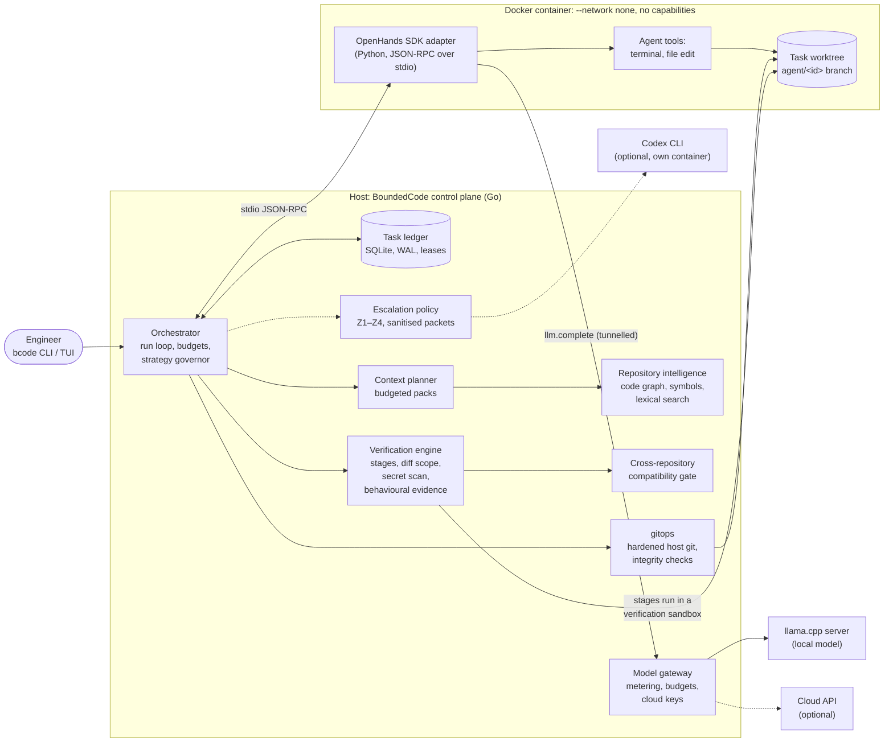
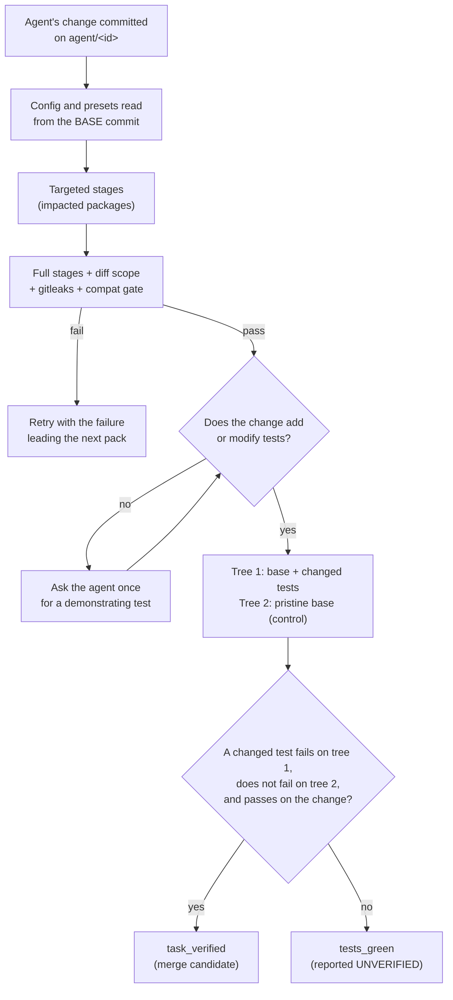

# BoundedCode: an engineering case study

*A control plane that will not call an AI coding agent's change "done"
just because the tests are green.*

Case study written 2026-10-10. Source:
[akynte/boundedcode](https://github.com/akynte/boundedcode) at release
[v0.1.0-alpha.5](https://github.com/akynte/boundedcode/releases/tag/v0.1.0-alpha.5)
(commit `5e1bea4`). Bracketed numbers such as [R12] refer to the
[references](#references), which link to files at that tag.

---

## Executive summary (for technical recruiters)

BoundedCode is an open-source control plane in Go for AI coding agents. It
runs an existing agent, the OpenHands SDK, against a local or cloud model,
inside a container with no network access. Its distinctive part is a
verification gate:
- **What it requires.** A change is reported **verified** only when a test
  the change adds fails on the original code and passes with the change.
- **Why that matters.** An agent's own green test suite was shown,
  repeatedly, to be weak evidence.

| Fact | Detail |
|---|---|
| Built by | One engineer (sole maintainer and architect). Implementation used AI coding agents heavily, under that design and review, as the README discloses [R1]. |
| Size | About 43,000 lines of Go plus 14,000 lines of Go tests (377 test functions), and a 735-line Python adapter. |
| History | 114 commits from 2026-10-03 to 2026-10-10; five pre-releases. |
| Held-out evaluation | On 6 public tasks never used in development, 5 were verified and passed the datasets' hidden tests, with no false verification [R30]. |
| Comparative evaluation | Pre-registered: 8 public tasks against the same agent and model without BoundedCode [R31]. |
| Comparison result | No success difference shown (7 of 8 vs 6 of 8), at about twice the time and tokens. Published as a negative result. |
| Security audit | Found a critical sandbox escape (host code execution through a nested git repository). It was fixed with a regression test and released [R33]. |
| Releases | Built and attested in CI (SLSA provenance), and rebuilt byte for byte from their tag [R36]. |

**What this demonstrates:**
- system design under hard constraints (one laptop with an 8 GB GPU,
  untrusted agent code);
- security engineering for agent sandboxes;
- careful empirical evaluation, including publishing results that do not
  flatter the project.

---

## Status legend

Every capability below carries one of four labels. They follow the
project's own status table [R4] and evaluation reports.

| Label | Meaning |
|---|---|
| **Validated** | Exercised in a published evaluation on real public repositories with a real model, with results measured against hidden acceptance tests. |
| **Implemented** | Code exists and is covered by unit, integration or adversarial tests (often with a scripted agent or fixtures), but has not been measured on real tasks. |
| **Partial / untested** | Implemented, but some paths are known to fail or have never been run (for example on macOS and Windows). |
| **Planned** | Designed or listed, but not implemented. |

---

## 1. The engineering problem and the motivating failure

Coding agents fail in two predictable ways on real repositories:

1. **They overflow context.** Pouring a repository into a prompt exceeds
   what a local model can hold and makes frontier models expensive.
2. **They mistake green tests for done.** An agent reports success because
   the suite passes, even when no test exercises the code it changed.

The second failure was not hypothetical. BoundedCode's first validation
(2026-10-04) ran a frozen build on 8 public tasks from SWE-bench
Multilingual and Multi-SWE-bench [R27]. Success was decided by the
datasets' hidden acceptance tests, which the agent never saw.

**Result: 0 of 8.** The verification gate at the time required only that
the repository's checks pass, and **4 of the 8 frozen runs self-verified
and then failed the hidden tests**. The report gives the causes:
- the existing tests "already passed on the untouched base";
- the missing signal was "any test that fails without the change";
- two patches were no-ops.

After five BoundedCode defects were fixed, reruns brought the result to
1 of 8. A two-task baseline on the same model found that BoundedCode did
not improve the result and was 17× and 2× slower [R28].

That failure set the project's direction. The verification model was
rebuilt around **behavioural evidence**, in commit `add3aab` ("Failure-driven
fixes: behavioural evidence…") [R29].

## 2. Why conventional passing tests were insufficient

A passing suite answers "did anything break?" It does not answer "does
anything show that this change does what was asked?"

The project's demo makes this concrete [R25]:
1. A small Go fixture prices 10 items at 1000 cents instead of 900 (a
   missing bulk discount), yet `go test ./...` passes on the buggy code.
2. The agent's first fix passed every check but added no test.
3. A gate that trusts green checks would accept that fix; nothing
   distinguishes it from a no-op.

A real, unscripted run with the local Qwen3.6-35B-A3B on an RTX 4060
laptop, on a fixture made for the demo. Waits longer than 2 s are cut to
2 s, so 150 s plays in about 33 s; the timestamps on each line are real.
[Unedited log](https://github.com/akynte/boundedcode/blob/v0.1.0-alpha.5/docs/assets/evidence-demo/session.log).
One run on a toy fixture shows the mechanism, not a success rate.

**The principle is not new.** SWE-bench itself defines a task by tests that
go from failing to passing. BoundedCode's contribution is applying that
principle **online, as a gate on an agent's own work**, without knowing
the answer in advance (section 7).

## 3. Constraints and design objectives

| Constraint | Consequence for the design |
|---|---|
| **One laptop:** Intel i7-13620H, RTX 4060 with 8 GB VRAM, 64 GB RAM, Debian 13 [R1] | The default local model, Qwen3.6-35B-A3B (a mixture-of-experts model), runs with most experts on the CPU. It decodes at 39.4 tokens/s with a 2 K-token prompt and 24.3 tokens/s with a 116 K-token prompt [R26]. Context has to be small and deliberate. |
| **The agent's code is untrusted** | Repository text can carry prompt injection. Every agent tool runs in a container. Verification is configured from the base commit, not from anything the agent can edit. |
| **Long tasks must survive Ctrl-C, crashes and reboots** | Durable state outside the model's conversation: the task ledger, not the chat, is the source of truth [R13]. |
| **Nothing happens on the user's behalf** | No push, merge or release. Work lands on `agent/<task-id>` branches in separate git worktrees. |
| **Upstream tools move fast** | Integrate, never fork: llama.cpp, OpenHands, codebase-memory-mcp and Serena run as separate processes or pinned dependencies [R5]. |
| **Claims must be checkable** | Every evaluation publishes its protocol, raw records and failures. |

## 4. Architecture and major components

The binary is one Go program (`cmd/boundedcode`). It has 34 internal
packages, layered so that lower layers never import the CLI or the
orchestrator [R3]. One task runs as follows. Each step is in
`Runner.Run` [R6]:

1. **Create.** The task row and worktree rows are written before the git
   worktree is created ("persist intent first").
2. **Start.** The run acquires a lease, reconciles any orphaned attempt
   from a crashed run, computes secret masks and dependency mounts, and
   opens the agent session in the sandbox.
3. **Contract.** The local model derives a task contract. A material
   ambiguity can stop the task to ask the user.
4. **Attempt.** Each attempt starts from a fresh, budgeted context pack.
   The agent works under the wall-clock limit and a strategy governor.
5. **Checkpoint.** The worktree's integrity is re-checked, then its
   changes are committed on the task branch.
6. **Verify.** Targeted checks run, then the full checks, then the
   cross-repository gate, then behavioural evidence.
7. **Decide.** The outcome is `task_verified` (merge candidate),
   `tests_green` (reported as UNVERIFIED), retry, escalate, or block. A
   blocked task keeps its work and can be resumed.

### What is original and what is integrated

| Capability | Origin | Integration |
|---|---|---|
| Agent loop and tools | **OpenHands Software Agent SDK 1.51.0** | Its own Python process inside the sandbox. BoundedCode wrote the adapter (735 lines) and its versioned JSON-RPC protocol [R10]. |
| Local inference | **llama.cpp v0.5.0** | A supervised `llama-server` process, with idle sleep and tuned mixture-of-experts offload [R5]. |
| Code graph and impact | **codebase-memory-mcp 0.11.0** | A persistent MCP session over BoundedCode's own JSON-RPC peer, with a CLI fallback [R9]. |
| Symbol navigation (optional) | **Serena 1.7.0** (MIT) | One read-only instance per worktree, pinned by a CI guard against its later GPL versions [R9]. |
| Secret scanning | **gitleaks 8.30.1** | A verification stage. The full gate fails if gitleaks is missing. |
| Frontier escalation (optional) | **Codex CLI** | Runs in its own container; only sanitised packets are sent [R21]. |
| Task ledger, leases, crash recovery | **BoundedCode** | `internal/task`, `internal/store`, `internal/orchestrator` |
| Budgeted context planner, retrieval seed ranking | **BoundedCode** | `internal/contextplan` |
| Verification engine and **behavioural evidence** | **BoundedCode** | `internal/verify` |
| Sandbox policy, command policy, git integrity | **BoundedCode** (on Docker or Podman) | `internal/sandbox`, `internal/policy`, `internal/gitops` |
| Model gateway (metering, budgets, cloud translation) | **BoundedCode** | `internal/inference` |
| Cross-service analysis and compatibility gate | **BoundedCode** | `internal/xservice`, `internal/compat` |
| Strategy governor, task contract, escalation policy | **BoundedCode** | `internal/orchestrator`, `internal/frontier` |

## 5. Bounded-context planning and retrieval

**Status: Validated** for the pack mechanism (it ran in every evaluation).
**Implemented** for individual retrieval paths, with unit tests.

The agent never receives the repository. Every attempt starts from a
**context pack**, built deterministically by `contextplan.Build` [R7]:
- **Budget.** 24,000 tokens by default.
- **Sections.** Ten, filled in priority order, each with a cap as a share
  of the budget [R7]:
  - task (10 %);
  - advice from the frontier model (15 %);
  - the failing verification output (25 %);
  - rejected strategies (6 %);
  - the current diff (25 %);
  - impact (10 %);
  - cross-service contracts (10 %);
  - code (30 %);
  - ADRs (8 %);
  - rules (5 %).
- **Overflow.** A section that would get less than 50 tokens is dropped,
  and an oversized one is truncated with a marker.
- **Three modes:**
  - **initial;**
  - **retry**, which leads with the failure;
  - **resume**, which states that the pack "was rebuilt from the task
    ledger, git and verification results; trust it over memory".

**Retrieval** is a chain that prefers the cheapest precise source
(`requestSymbols` [R8]):
1. Names are ranked by seed ranking, which demotes common sample names.
2. Compiler and test diagnostics are located by fixed-string search.
3. In multi-repository tasks, the code graph decides which repository
   mentions a name.
4. Serena answers symbol queries in the task's worktree.
5. If Serena is unavailable, the code graph's snippet and callers are used.
6. A bounded whole-word ripgrep is the last resort.

**Impact** queries run against an index of the **task worktree**, so they
see the agent's changes.

**Integration choice.** ADR-0006 replaced one-shot calls to the
code-graph CLI with a persistent MCP session after a measurement: about
4 s per query for the CLI, against about 12 ms per query for the session
[R9].

**Measured context use** (held-out validation, upper bounds including all
tool output) [R30]:

| Repository | Size, in estimated source tokens | Context used |
|---|---|---|
| prometheus | 1.83 M | 29.2 K tokens (**1.6 %**) |
| vuejs/core | 1.22 M | 33.2 K (2.7 %) |
| gin | 0.12 M | 35.0 K (29.1 %) |

All six tasks used roughly 18–35 K tokens each, whatever the repository's
size.

**Trade-off.** A small pack means the agent must read further code through
its tools, so the pack's *quality* matters more than its size. The
targeted engineering pass added retrieval seed ranking for exactly this
reason [R29].

## 6. Agent orchestration and durable task execution

**Status:**
- **Implemented** with a real-process crash test.
- **Validated** once on a real task: a resume with 4 context condensations
  on Prometheus [R27].

**The ledger is the source of truth** (ADR-0002) [R13]:
- **Storage.** Embedded SQLite through the pure-Go `modernc.org/sqlite`,
  in WAL mode, with append-only migrations.
- **Persist then act.** Every transition is written before its side
  effect:
  - the worktree row before the worktree;
  - the attempt counter and an "in progress" strategy row before the
    agent's turn;
  - the escalation row before the question is sent.

**Leases** (`AcquireLease` [R12]):
- **Acquiring.** A single conditional `UPDATE` claims the task if it is
  free, already ours, or its heartbeat is stale.
- **Renewing.** A heartbeat every 15 s.
- **Taking over.** A second process takes over only after 2 minutes of
  silence.
- **Cancellation.** A cancellation is never overwritten by a late save.

**Crash recovery is tested with a real SIGKILL** (`TestSIGKILLResume`
[R14]):
1. The test re-executes itself as a child runner whose agent writes a file
   and hangs, then kills the child with `SIGKILL`.
2. While the lease is fresh, a second runner is refused.
3. Once the lease is stale, a third runner takes it over and marks the
   orphaned attempt "rejected: previous run stopped".
4. The killed attempt's edits are still there.
5. The third runner finishes the task from a pack rebuilt from the ledger.

**Caveat:** the agent in this test is scripted, not the OpenHands adapter.

**Budgets and runaway control:**
- **Per task:** 6 attempts, 4 hours of wall clock and 4 M local tokens.
- **Per response:** an 8,192-token output cap.
- **Strategy governor** [R15]: it stops an attempt that generates
  40 K tokens without progress, or exceeds 50 K tokens or 35 minutes. The
  stop is recorded and that strategy is not retried.
  - **Why it exists:** in development, "72–109 K generated tokens per
    unproductive attempt" were observed [R29].
  - **Status:** **Implemented**, but no live stop has been observed in an
    evaluation [R4].
- **Infrastructure failures** (an unreachable model server, cloud 429 or
  5xx) are retried without using up an attempt. Authentication failures
  block the task immediately.

**The agent boundary** (ADR-0004) [R10]:
- **Protocol.** The Python adapter speaks newline-delimited JSON-RPC 2.0
  over the container's stdio. LiteLLM inside it points at a loopback
  proxy that turns every model call into an `llm.complete` request back
  to the Go gateway.
- **Why it matters:**
  - the sandbox needs no network at all;
  - all metering and budget enforcement happens on the host;
  - cloud API keys never enter the container.
- **Protocol versioning.** Both sides refuse a mismatched protocol
  version.

**Task contract** (experimental) [R16]:
- The local model derives the requirements before the first attempt.
- A second call checks each "material ambiguity" against quotes from the
  request.
- By default, a material ambiguity stops the task to ask.
- **Status: Partial.** In the held-out run, 2 of 6 derivations were empty
  and 1 of 6 flagged a false ambiguity [R4].

**Frontier escalation** (ADR-0009) [R21]:
- **Policy.** A deterministic Z1–Z4 policy decides when to ask a stronger
  model. "No model decides whether to escalate."
- **Packets.** They are compacted and redacted, host paths are rewritten,
  and a fail-closed check refuses any packet that still contains a home
  directory path.
- **Status: Implemented, value unproven.**
  - Tested against a fake, with one live run.
  - In the first validation it sent 4 questions, and none of those tasks
    was accepted.
  - In the held-out validation it never triggered [R1].

## 7. Behavioural verification architecture

**Status: Validated.** It decided every result in the held-out and
comparative evaluations.

### The gate

The design has four parts.

**1. The agent cannot weaken its own gate** [R17, R18].
- **Configuration from the base commit.** The verification configuration
  (`.boundedcode/verification.yaml`) is read from the **base commit** with
  `git cat-file`, never from the worktree.
- **Fallback presets.** Without a configuration, presets are chosen from
  the base commit's file list. They cover Go, JavaScript/TypeScript,
  Python, Rust, Java, C/C++, Ruby, PHP, Terraform and Helm.
- **Protected paths.** A change to `.boundedcode/`, CI workflows,
  CODEOWNERS or `.gitmodules` fails the diff-scope stage.
- **Deleted requirements.** Deleting a file a stage requires fails that
  stage.
- **Tested:** `TestAgentCannotWeakenVerification`.

**2. Checks are deterministic and sandboxed.**
- **Where stages run.** In their own container: offline, with read-only
  dependency mounts, a per-task build cache, and command policy applied to
  every stage.
- **Side effects.** Anything verification writes is undone afterwards; an
  undo that fails is a failure.
- **Secret scanning.** The task's diff is piped to gitleaks. If gitleaks is
  missing, the full gate errors instead of passing [R18].

**3. Behavioural evidence** (`Engine.BehaviourEvidence` [R19]). The
evidence check builds two trees from the base commit:
- **base + changed tests:** the change's added or modified test files laid
  over the base;
- **control:** the pristine base.

A test counts as evidence only when all three of these hold:
1. **It fails with the changed tests on the base.** A failure to build on
   the base is recorded as "not built" and is **not** evidence. Testing new
   API that does not exist on the base proves nothing about behaviour.
2. **It does not fail in the control.** A failure the base already had
   does not count.
3. **It passes on the change.** For Go, each candidate is re-run with
   `-run ^(names)$ -v` and must report `--- PASS`. A skipped test does not
   count. This rule closed audit finding H2 [R33].

**Attribution.**
- **Go:** per test function, including **test data**. A changed file
  under `testdata/` is attributed to the package whose tests read it,
  which fixed the held-out validation's false negative [R30].
- **Ten other runners:** per test, with the failure parsed from the
  runner's output. The runners are pytest, unittest, cargo, Maven
  Surefire, Gradle, minitest, RSpec, PHPUnit, CTest and Meson.
- **JavaScript and custom stages:** per stage.

**Tested.** `TestBehaviourEvidenceGoCases` covers eight cases [R20]. Among
them:
- a test that already passes on the base;
- a test of new API that does not build there;
- a failure the base already had;
- a test skipped on the change;
- a data-driven test in a sub-package.

**4. Outcomes are named honestly.**
- **`task_verified`:** every check passed **and** evidence exists.
- **`tests_green`:** every check passed but evidence does not exist. It is
  reported as **"UNVERIFIED candidate: checks are green but …"**, with the
  reason. The task finishes, but is not called verified.

### What the evidence gate cannot do

The project states these limits in its own docs [R17, R33]:
- **It cannot tell which reading of an issue is right.** A test can encode
  the wrong one of several valid readings and still provide evidence.
- **Python and JavaScript tests of newly added API can count as
  evidence.** The "does not build on base" guard is reliable only for Go
  (audit finding H4, open).
- **Flaky tests can become evidence** (audit finding M2, open).

## 8. Sandboxing and security boundaries

**Status:**
- **Implemented**, with adversarial tests.
- **Validated** in the sense that every evaluation run executed inside the
  sandbox.
- The live container-escape probes need the sandbox image. They have run
  locally. A weekly CI job for them was added on 2026-10-10 and has not
  run yet.

**Threat model.** The model may be wrong or adversarially steered. Text in
the repository can instruct it [R22]. Agent-level permission prompts are
explicitly **not** treated as a security boundary (ADR-0003).

| Layer | Control | Reference |
|---|---|---|
| Container | `--network none`, `--cap-drop ALL`, `no-new-privileges`, a PID limit, memory and CPU limits, a private tmpfs `$HOME`. Mounting `/`, `$HOME`, the Docker socket, `~/.ssh` or cloud and package-manager credential paths is refused. | `Container.Args` [R23] |
| Secrets in the worktree | `.env*`, keys and credential files are masked with an empty read-only file or a 0500 tmpfs. More than 500 matches refuses the run instead of partly masking. | `internal/policy` [R24] |
| Model traffic | Tunnelled over stdio; the container has no network. Cloud keys stay on the host gateway, in the OS keyring. | ADR-0004, ADR-0010 |
| Commands in verification | A deterministic policy blocks push, hard reset, protected-branch merges, `terraform apply`, mutating `kubectl` and `helm`, publishing, and `curl … \| sh`. It first normalises wrappers, global flags and `sh -c` bodies, so obfuscations like `git -C . push` or `bash -lc "FOO=1 git push"` are caught. | `CheckCommand` [R24] |
| Host git | Hooks, fsmonitor and ext protocols are off, and submodules are ignored. Before any host git call, the worktree's `.git` pointer, its admin directory, `commondir` and `HEAD` are verified. Nested repositories are refused. File names are read NUL-separated. | `gitops` [R11] |
| Host-side reads | Context packs never follow a symlink out of the worktree or read a secret path. | `ReadConfined` [R7] |

**Adversarial tests:**
- `TestPromptInjectedAgentIsContained` [R22] scripts an agent that tries
  three attacks, and each is contained:
  - **it rewrites the verification config:** rejected;
  - **it plants `leak.go -> id_ed25519`:** the canary never reaches a
    pack;
  - **it pushes:** refused by policy.
- `TestAdversarialContainer` [R23] probes from inside the real container:
  - reading masked files;
  - a host environment canary;
  - the host `$HOME`;
  - an HTTP request to `1.1.1.1`;
  - the Docker socket;
  - the capability set and the user.

**A critical finding, and its fix.** The readiness audit (2026-10-09) found
a way past these controls [R33]:
- **The attack.** An agent could create a nested git repository inside its
  worktree, with a malicious clean filter in that repository's own config.
  The host's `git status` and `git add -A` then ran that filter **on the
  host**. This was reproduced with git 2.47.3.
- **The fix** (commit `48274a1`):
  - host git ignores submodules;
  - a checkpoint refuses a worktree holding a nested repository;
  - `TestNestedRepositoryConfigNotExecuted` guards it.
- **A related high-severity finding** in the same commit: git's C-quoted
  file names (for example a new `.github/workflows/cié.yml`) slipped past
  the protected-path policy.
- **Shipped** in v0.1.0-alpha.5.

**Open residual risks** [R22]. The design document lists 15. The most
material:
1. **Secrets in git history.** Secrets committed to git history, and
   tokens in `.git/config`, remain readable inside the sandbox, because the
   object store is mounted read-only rather than masked.
2. **Agent-writable build scripts.** They are agent-writable, so
   verification catches mistakes, not an adversary.
3. **The frontier container.** It has network access and the Codex
   credentials.
4. **Container escape** itself is out of scope.
5. **Root.** The container runs as the invoking user, so it runs as root
   only if BoundedCode itself does. Nothing refuses UID 0.

## 9. Cross-repository compatibility checks

**Status:**
- **Implemented**, tested on fixtures, with one real-CLI run on the
  fixture with Docker.
- **Not run on a real multi-repository task** [R4].

**The problem.** In a multi-repository task, each repository's own tests
can pass while the contract between them breaks. For example, a protobuf
field is renamed in the provider, but a consumer in another repository
still builds against its vendored generated code.

**How the gate works** [R32]:
1. **Detection.** The cross-service analyser (`internal/xservice`) finds
   links between the task's repositories. The gate evaluates gRPC,
   protobuf and OpenAPI links.
2. **Exported trees.** The base and head commits of every repository are
   exported with `git archive`; the worktree is never read directly.
3. **Structural comparison:**
   - **`.proto` definitions:** removed, renumbered, retyped or renamed
     fields, removed enum values and changed RPC signatures are breaking;
   - **OpenAPI:** operations are compared together with the schemas they
     reference;
   - **Go code:** compared by enclosing function.
4. **Real execution.** The consumer's tests run in the sandbox against the
   **candidate** provider, through a generated `go.work`, with coverage.
   "Exercised" means coverage blocks in the provider were hit. OpenAPI
   links use a knock-out run: remove the operation and see whether a test
   fails.
5. **Verdicts:**
   - **`compatible`:** every need was exercised and passed;
   - **`broken`:** a consumer still uses a removed definition, or a
     failure is attributed to the provider;
   - **`untested`:** anything else, with a reason.
6. **Effect on the outcome.** Anything other than `compatible` withholds
   `task_verified`.

**Tested:**
- `TestBreakMissedBySingleRepositoryTests` shows the motivating case:
  every repository is green on its own, and the gate reports `broken`.
- `TestGateBypassAttempts` covers three bypasses:
  - editing the verification config;
  - a `replace` directive pointing at a stale copy;
  - a private copy of the generated code.

**Prior art.** Schema-level breaking-change detection exists, for example
`buf breaking` for protobuf. What the gate adds is **executing** the
consumers against the candidate provider, inside the same sandbox and
evidence model as the rest of verification.

**Limits** [R32]:
- Go sides only for gRPC and protobuf, and no nested Go modules.
- `protoc` is never run.
- A client is never run against a real server.

## 10. Major trade-offs and rejected alternatives

| Decision | Chosen | Rejected, and why | Source |
|---|---|---|---|
| Relationship to upstream tools | Integrate as processes and pinned dependencies | **Forking** would mean maintaining fast-moving upstream code | ADR-0001 |
| Control-plane state | Embedded SQLite (WAL) | **PostgreSQL**: a service to run, for a single-user tool. The case study's section 13 notes when that changes. | ADR-0002 |
| Isolation | Container per agent session | **Agent permission prompts**: not an isolation boundary | ADR-0003 |
| Agent transport | JSON-RPC over stdio | **Unix socket**: a socket bind-mounted from the host does not reach the container under Docker Desktop (the ADR's recorded reason). **Localhost HTTP** was the third option considered. Stdio also needs no network path at all, so the container keeps `--network none`. | ADR-0004 |
| Code-graph access | Persistent MCP session | **One-shot CLI**: about 4 s per query, against about 12 ms | ADR-0005 → ADR-0006 |
| Symbol navigation | One read-only Serena per worktree, optional | **One instance per task**: wastes language-server warm-up. **One instance switching projects**: serialises everything and risks wrong-project answers. **Symbol editing**: a cold TypeScript rename changed only the declaration. | ADR-0008 |
| Default model | Qwen3.6-35B-A3B | **Laguna XS 2.1** solved 11 of 11 synthetic tasks and 4 of 4 hard repeats, against Qwen's 10 of 11 and 1 of 4. But it was 2.6× slower (7.0 vs 18.2 verified tasks/hour), and its license (OpenMDW-1.1) is not on the SPDX list. Speed was chosen, relying on verification to catch the weakness. | ADR-0007 [R26] |
| When to escalate | Deterministic Z1–Z4 policy | **Letting a model decide**: not auditable, not budgetable | ADR-0009 |
| Verification strictness | Evidence required for `task_verified` | **Accepting green checks**: produced 4 of 8 false passes in the first validation. **The cost:** correct changes without a demonstrating test end `tests_green`. That was 3 of BoundedCode's 8 runs in the comparative evaluation. | [R27, R31] |
| Formatting and lint in the gate | The project's own checks are enforced | **Ignoring them**: they are the project's rules. **The cost:** some correct patches are rejected for formatting (section 11). | [R31] |
| Context | Budgeted packs | **Whole-repository prompts**: do not fit a local model, and are expensive on frontier models | [R7] |

## 11. Benchmark methodology and actual results

Every evaluation used public SWE-bench-style tasks:
- **Hidden tests.** Success was decided by the dataset's **hidden**
  acceptance tests, applied after the run and never visible to the agent.
- **Setting.** One machine, the local model, one run per task.
- **Publication.** Raw records, failures and errata are in the
  repository [R2].

| Evaluation (date) | Tasks and selection | Result | What it shows |
|---|---|---|---|
| **Initial validation** (2026-10-04) [R27] | 8 tasks. Fixed hash ranking per slot, screened for environment validity only. | **0/8** on the frozen build, with 4 false verification passes. **1/8** after fixing five BoundedCode defects. | Green checks are weak evidence; it motivated behavioural evidence. |
| **Failure-driven pass** (2026-10-05) [R29] | The same 4 failed tasks plus one control. **Development evidence, not validation.** | 1 of 4 development tasks; 3 false passes (each an issue/hidden-test mismatch) | The evidence gate stopped no-op passes, but not passes where the issue allows another reading. |
| **Targeted pass** (2026-10-05) [R29] | 2 development tasks | **0 of 2** (0 of 3 runs) | It added runaway control, the task contract and retrieval seeds; no measured gain. |
| **Held-out validation** (2026-10-05) [R30] | 6 tasks from 24 hash-ranked candidates. 10 were rejected because their hidden tests could not be derived from the issue. Frozen before the first run. | **5 of 6** `task_verified` and passing hidden tests, all with the local model only. **6 of 6** hidden tests passed. **0 false passes; 1 false negative.** | The gate behaves as designed on screened tasks. 95 % interval for 5 of 6: about 36–99.6 %. |
| **Comparative evaluation** (2026-10-09/10) [R31] | 8 tasks with **no** difficulty or clarity screening, 6 from repositories never used in development. A frozen protocol and deviations log. | Hidden tests: **BoundedCode 7 of 8, plain agent 6 of 8.** | **No success difference shown** (McNemar p = 1.0). The single discordant task changed between two runs of the baseline. |

### The comparative evaluation in more detail

This is the project's strongest piece of evidence, because it includes a
baseline [R31]:
- **Baseline.** The same OpenHands SDK, model, sandbox and 60-minute
  limit, without BoundedCode.
- **Pre-registration.** The protocol, task set and tooling were committed
  before any comparative run.
- **Deviations.** Three changes after the freeze were documented and
  committed before the runs they affect.
  - One was a harness defect that had denied the **baseline** its build
    environment. That arm was re-run, and **both arms are published**.

**Results:**
- **Cost.** BoundedCode used 2.3× the wall-clock time (126 vs 56 minutes)
  and 2.1× the processed tokens (862 K vs 413 K).
- **The gate on the plain agent's 16 patches** (replay):
  - it accepted 8, and all 8 pass the hidden tests;
  - it rejected 8: **all 4** that fail the hidden tests (a compile error,
    a broken existing test, a test run out of memory, formatting), and
    **4 that pass**. Two of those were rejected for formatting, and two
    for breaking an existing test that the dataset's own reference fix
    also breaks.
  - It found **no defect that the hidden tests missed**. A draft claim
    that it had was checked against the reference fix and withdrawn.
- **The gate on BoundedCode's own runs:**
  - **one false verification** (gin-3820): the hidden test checks a
    different layer than the issue names;
  - **three missed verifications** of correct changes: two repositories
    had no usable test stage offline, and in one the agent's test also
    passed on the base.

**Reading.** On this sample, BoundedCode's architecture shows no success
advantage. Its verification gate is a reliable reject filter: every
failing patch was rejected. But it rejects as many correct patches, and
behavioural evidence predicts hidden-test success no better than green
checks (6 of 7 against 11 of 12). These are eight tasks, one run each, and
the report does not extrapolate.

### False verification passes, all of them

The reports document 12 cases where verification or self-verification
passed but the hidden tests failed [R27–R31]:
- **6 came from the earlier gate design**, before behavioural evidence;
  that is the motivating failure.
- **5 came from development runs** with the current design:
  - **four are issue/test mismatches:** the hidden test requires a detail
    the issue does not state, or one of several valid readings;
  - **one** (caddy, targeted pass) was credited on changed tests that did
    not build against the base. That is a weaker signal, which the gate no
    longer accepts as evidence.
- **1 came from the comparative evaluation**, an issue/test mismatch like
  the four above.

None of the six later cases is a no-op patch, the class the evidence gate
was built to stop.

## 12. Failures, limitations and unresolved questions

**Limitations stated by the project** [R1, R4]:
- **The sample is small.** 8 + 6 + 8 public tasks, each run once, on one
  machine with one model. Variance between runs was not measured, though
  the comparative evaluation shows it is large.
- **No baseline advantage.** No baseline advantage has been shown, either
  in the 2-task baseline or in the 8-task comparative evaluation.
- **Platforms.** macOS and Windows are experimental. In CI, 5 test
  packages fail on macOS and 14 on Windows. Four of the causes are filed
  as first-contribution issues.
- **Unmeasured features:**
  - **Cloud model providers:** no live API calls or real tasks yet;
  - **hardware-based model choice:** profiles not benchmarked;
  - **frontier escalation:** no shown benefit;
  - **the strategy governor:** no live stop observed;
  - **the cross-repository gate:** never run on a real task.
- **Open audit findings** [R33]:
  - secrets readable through the git object store;
  - non-Go new-API tests counting as evidence;
  - flaky tests as evidence;
  - a race window between the worktree check and host git (reasoned, not
    reproduced);
  - case-sensitive secret-name matching.

**Unresolved questions:**
1. Does behavioural evidence improve outcomes, or only labelling? The
   comparative data shows it labels conservatively, but no ablation has
   measured its effect on success.
2. Would the gate's defect detection translate into better outcomes if
   the agent were told what the gate found? BoundedCode's own runs never
   needed that path.
3. How much of the held-out 5 of 6 comes from screening? The screen
   removed tasks whose hidden tests need identifiers that only the
   reference fix introduces, a failure class seen in development.
4. Is the 2× cost acceptable for any measurable gain? None has been shown
   yet.

## 13. Lessons learned and future validation priorities

**Lessons:**

1. **Measure the gate, not just the agent.** The first validation's most
   useful output was not its score of 0/8. It was the discovery that 4 of
   8 "verified" results were false, which the 0/8 alone would not have
   shown.
2. **Strictness has a price you must report.** Requiring evidence removed
   no-op false passes, but correct changes now end `tests_green` when no
   demonstrating test is possible offline. Publishing that cost is part of
   the result.
3. **A harness defect can bias a comparison.** The baseline's missing
   build environment (deviation D3) would have handed BoundedCode a win on
   one task. Re-running that arm and publishing both arms was the only
   defensible fix.
4. **With small samples, variance dominates.** The identity of the one
   task where the two systems differed changed between two baseline runs.
   Single-run differences on 8 tasks should be read as noise until
   repeated.
5. **Check your own claims against the reference.** A draft finding (a
   regression "missed by the hidden tests") was withdrawn after checking
   it against the dataset's reference fix.
6. **Security review finds what tests do not.** The critical
   nested-repository escape survived a test suite full of adversarial
   cases. It was found by reasoning about what host git does inside an
   agent-writable tree.

**Future validation priorities, in order:**
1. **Repeated runs** on a larger, unscreened task set, with enough tasks
   to detect a 10–15 point difference.
2. **An ablation** of behavioural evidence on the same tasks: gate on vs
   gate off.
3. **The cross-repository gate on real multi-repository tasks.**
4. **macOS and Windows:** green unit tests, then the full flow.
5. **The non-Go evidence gaps:** new-API tests and flaky tests.

**At larger scale.** The single SQLite ledger and per-machine sandbox suit
a single-user tool. Running many engineers' tasks would first need a
shared task store with real leases (for example Postgres with row locks)
and a scheduler for GPU time. The state boundaries were drawn so those
parts can change without touching the verification gate.

---

## Supply chain and release engineering

**Status: Implemented and measured** [R36].
- **Built in CI.** Releases are built by a GitHub Actions workflow from a
  pushed tag. It runs the tests and `make dist`, attests every file with
  SLSA build provenance (Sigstore), and creates a **draft** that the
  maintainer publishes.
- **Rebuilt independently.** v0.1.0-alpha.5 was rebuilt locally from its
  tag:
  - all 6 binaries and all 6 SBOMs were byte-identical to the release;
  - the licenses archive was identical under `umask 022`. A permission-bit
    difference under another umask was found and fixed for future
    releases.
  - All 14 assets pass `gh attestation verify`.
- **Pins.** Upstream components are pinned by commit and checksum.
- **CI checks:**
  - govulncheck, license checks and gitleaks over the full history;
  - a DCO sign-off on every commit.

---

## Résumé bullets

These are factual and each is backed by the linked evidence. The README
discloses that implementation used AI coding agents under the author's
design and review [R1]. For applications that ask about AI assistance,
phrase the first bullet as "designed and led".

- **Designed and built BoundedCode**, an open-source Go control plane for
  AI coding agents (about 43 K lines of Go, 377 test functions). It runs
  the OpenHands agent against a local llama.cpp model inside a
  network-less Docker sandbox, with a crash-safe SQLite task ledger and
  budgeted context packs. [R3, R6, R13]
- **Built a behavioural verification gate.** An agent's change counts as
  verified only when a test it adds fails on the base commit (in a
  control-checked rebuilt tree) and passes with the change. The gate came
  out of an evaluation where 4 of 8 "verified" results were false. [R19,
  R27]
- **Ran a pre-registered comparative evaluation** against the same agent
  and model without the control plane, on 8 public SWE-bench Multilingual
  tasks. Published the negative result: no success difference (7 of 8 vs
  6 of 8) at 2.3× the time. Also published that the gate rejected every
  failing baseline patch. [R31]
- **Found and fixed a critical sandbox escape** in a security audit: host
  code execution through a nested git repository in the agent's worktree.
  Also fixed a policy bypass through git-quoted file names. Both have
  regression tests and shipped in a release. [R11, R33]
- **Tested crash recovery with a real SIGKILL:** lease takeover, recovery
  of the orphaned attempt, and resumption from the ledger. [R14]
- **Made releases verifiable.** They are built and attested in CI (SLSA
  provenance), with reproducible binaries and SBOMs, confirmed by an
  independent rebuild. [R36]

---

## References

All links point at tag `v0.1.0-alpha.5` (commit `5e1bea4`) unless stated
otherwise. The base URL is
`https://github.com/akynte/boundedcode/blob/v0.1.0-alpha.5/`.

| Ref | What | Link |
|---|---|---|
| R1 | README: reference hardware, "How this was built", known limitations, frontier status | [README.md](https://github.com/akynte/boundedcode/blob/v0.1.0-alpha.5/README.md) |
| R2 | Evaluation overview | [docs/benchmarks/README.md](https://github.com/akynte/boundedcode/blob/v0.1.0-alpha.5/docs/benchmarks/README.md) |
| R3 | System architecture | [docs/architecture/system-architecture.md](https://github.com/akynte/boundedcode/blob/v0.1.0-alpha.5/docs/architecture/system-architecture.md) |
| R4 | Implementation status (implemented, experimental, planned) | [docs/development/status.md](https://github.com/akynte/boundedcode/blob/v0.1.0-alpha.5/docs/development/status.md) |
| R5 | Upstream components and pins | [docs/architecture/upstream-components.md](https://github.com/akynte/boundedcode/blob/v0.1.0-alpha.5/docs/architecture/upstream-components.md) |
| R6 | The run loop, `Runner.Run` | [internal/orchestrator/runner.go#L202](https://github.com/akynte/boundedcode/blob/v0.1.0-alpha.5/internal/orchestrator/runner.go#L202) |
| R7 | Context pack sections, budgets, `Build`, `ReadConfined` | [internal/contextplan/plan.go#L92](https://github.com/akynte/boundedcode/blob/v0.1.0-alpha.5/internal/contextplan/plan.go#L92), [#L109](https://github.com/akynte/boundedcode/blob/v0.1.0-alpha.5/internal/contextplan/plan.go#L109), [#L447](https://github.com/akynte/boundedcode/blob/v0.1.0-alpha.5/internal/contextplan/plan.go#L447) |
| R8 | Retrieval chain, `requestSymbols` | [internal/contextplan/symbols.go#L81](https://github.com/akynte/boundedcode/blob/v0.1.0-alpha.5/internal/contextplan/symbols.go#L81) |
| R9 | ADR-0006 (persistent MCP session) and ADR-0008 (Serena) | [0006](https://github.com/akynte/boundedcode/blob/v0.1.0-alpha.5/docs/architecture/adr/0006-persistent-mcp-session.md), [0008](https://github.com/akynte/boundedcode/blob/v0.1.0-alpha.5/docs/architecture/adr/0008-serena-symbol-navigation.md) |
| R10 | ADR-0004 (adapter protocol); the `llm.complete` tunnel | [0004](https://github.com/akynte/boundedcode/blob/v0.1.0-alpha.5/docs/architecture/adr/0004-adapter-protocol.md), [runtime.go#L210](https://github.com/akynte/boundedcode/blob/v0.1.0-alpha.5/internal/agent/openhands/runtime.go#L210) |
| R11 | Host git hardening, `CheckWorktree`, `checkNoNestedRepos`, `TestNestedRepositoryConfigNotExecuted` | [git.go#L32](https://github.com/akynte/boundedcode/blob/v0.1.0-alpha.5/internal/gitops/git.go#L32), [#L300](https://github.com/akynte/boundedcode/blob/v0.1.0-alpha.5/internal/gitops/git.go#L300), [#L345](https://github.com/akynte/boundedcode/blob/v0.1.0-alpha.5/internal/gitops/git.go#L345), [git_test.go#L256](https://github.com/akynte/boundedcode/blob/v0.1.0-alpha.5/internal/gitops/git_test.go#L256) |
| R12 | Leases, `AcquireLease` | [internal/task/task.go#L209](https://github.com/akynte/boundedcode/blob/v0.1.0-alpha.5/internal/task/task.go#L209) |
| R13 | ADR-0002 (embedded SQLite) | [0002](https://github.com/akynte/boundedcode/blob/v0.1.0-alpha.5/docs/architecture/adr/0002-embedded-sqlite-state.md) |
| R14 | `TestSIGKILLResume` | [internal/orchestrator/crash_test.go#L50](https://github.com/akynte/boundedcode/blob/v0.1.0-alpha.5/internal/orchestrator/crash_test.go#L50) |
| R15 | Strategy governor | [internal/orchestrator/governor.go#L60](https://github.com/akynte/boundedcode/blob/v0.1.0-alpha.5/internal/orchestrator/governor.go#L60) |
| R16 | Task contract and ambiguity gate | [internal/orchestrator/contract.go#L190](https://github.com/akynte/boundedcode/blob/v0.1.0-alpha.5/internal/orchestrator/contract.go#L190) |
| R17 | Verification guide (outcomes, evidence rules, limits) | [docs/usage/verification.md](https://github.com/akynte/boundedcode/blob/v0.1.0-alpha.5/docs/usage/verification.md) |
| R18 | Config from the base commit (`LoadConfig`), diff scope, secret scan, `TestAgentCannotWeakenVerification` | [verify.go#L190](https://github.com/akynte/boundedcode/blob/v0.1.0-alpha.5/internal/verify/verify.go#L190), [#L362](https://github.com/akynte/boundedcode/blob/v0.1.0-alpha.5/internal/verify/verify.go#L362), [#L394](https://github.com/akynte/boundedcode/blob/v0.1.0-alpha.5/internal/verify/verify.go#L394), [verify_test.go#L112](https://github.com/akynte/boundedcode/blob/v0.1.0-alpha.5/internal/verify/verify_test.go#L112) |
| R19 | Behavioural evidence, `BehaviourEvidence` and `goTestsPass` | [delta.go#L124](https://github.com/akynte/boundedcode/blob/v0.1.0-alpha.5/internal/verify/delta.go#L124), [#L375](https://github.com/akynte/boundedcode/blob/v0.1.0-alpha.5/internal/verify/delta.go#L375) |
| R20 | Evidence test cases | [delta_test.go#L111](https://github.com/akynte/boundedcode/blob/v0.1.0-alpha.5/internal/verify/delta_test.go#L111) |
| R21 | ADR-0009 (frontier escalation); `frontier.Evaluate` | [0009](https://github.com/akynte/boundedcode/blob/v0.1.0-alpha.5/docs/architecture/adr/0009-frontier-escalation.md), [policy.go#L57](https://github.com/akynte/boundedcode/blob/v0.1.0-alpha.5/internal/frontier/policy.go#L57) |
| R22 | Sandbox design: controls and residual risks; `TestPromptInjectedAgentIsContained` | [docs/design/sandbox.md](https://github.com/akynte/boundedcode/blob/v0.1.0-alpha.5/docs/design/sandbox.md), [adversarial_test.go#L24](https://github.com/akynte/boundedcode/blob/v0.1.0-alpha.5/internal/orchestrator/adversarial_test.go#L24) |
| R23 | Container arguments; `TestAdversarialContainer` | [sandbox.go#L163](https://github.com/akynte/boundedcode/blob/v0.1.0-alpha.5/internal/sandbox/sandbox.go#L163), [adversarial_test.go#L13](https://github.com/akynte/boundedcode/blob/v0.1.0-alpha.5/internal/sandbox/adversarial_test.go#L13) |
| R24 | Command policy and secret and protected paths | [policy.go#L210](https://github.com/akynte/boundedcode/blob/v0.1.0-alpha.5/internal/policy/policy.go#L210), [#L231](https://github.com/akynte/boundedcode/blob/v0.1.0-alpha.5/internal/policy/policy.go#L231) |
| R25 | Evidence demo: scenario, recording, unedited log | [demo/evidence/README.md](https://github.com/akynte/boundedcode/blob/v0.1.0-alpha.5/demo/evidence/README.md) |
| R26 | Model evaluation and decode-speed reference run; ADR-0007 | [model-evaluation.md](https://github.com/akynte/boundedcode/blob/v0.1.0-alpha.5/docs/design/model-evaluation.md), [infra report](https://github.com/akynte/boundedcode/blob/v0.1.0-alpha.5/benchmarks/reports/20261003T161953Z-infra-qwen3.6-35b-a3b.md), [0007](https://github.com/akynte/boundedcode/blob/v0.1.0-alpha.5/docs/architecture/adr/0007-default-model.md) |
| R27 | Initial validation (0/8, then 1/8) | [small-real-world-validation-2026-10.md](https://github.com/akynte/boundedcode/blob/v0.1.0-alpha.5/docs/benchmarks/small-real-world-validation-2026-10.md) |
| R28 | Two-task baseline | [baseline-comparison.md](https://github.com/akynte/boundedcode/blob/v0.1.0-alpha.5/benchmarks/reports/small-real-world-validation-20261004/baseline-comparison.md) |
| R29 | Failure-driven and targeted engineering passes (development evidence) | [failure-driven](https://github.com/akynte/boundedcode/blob/v0.1.0-alpha.5/docs/benchmarks/failure-driven-engineering-2026-10.md), [targeted](https://github.com/akynte/boundedcode/blob/v0.1.0-alpha.5/docs/benchmarks/targeted-engineering-pass-2026-10.md) |
| R30 | Held-out validation (5 of 6) | [second-independent-validation-2026-10.md](https://github.com/akynte/boundedcode/blob/v0.1.0-alpha.5/docs/benchmarks/second-independent-validation-2026-10.md) |
| R31 | Comparative evaluation: protocol, deviations, report, raw results | [report.md](https://github.com/akynte/boundedcode/blob/v0.1.0-alpha.5/benchmarks/comparative-2026-10/report.md), [protocol.md](https://github.com/akynte/boundedcode/blob/v0.1.0-alpha.5/benchmarks/comparative-2026-10/protocol.md), [deviations.md](https://github.com/akynte/boundedcode/blob/v0.1.0-alpha.5/benchmarks/comparative-2026-10/deviations.md), [results/](https://github.com/akynte/boundedcode/tree/v0.1.0-alpha.5/benchmarks/comparative-2026-10/results) |
| R32 | Cross-repository compatibility design; gate tests | [cross-repo-compatibility.md](https://github.com/akynte/boundedcode/blob/v0.1.0-alpha.5/docs/design/cross-repo-compatibility.md), [gate_test.go#L253](https://github.com/akynte/boundedcode/blob/v0.1.0-alpha.5/internal/compat/gate_test.go#L253), [#L498](https://github.com/akynte/boundedcode/blob/v0.1.0-alpha.5/internal/compat/gate_test.go#L498) |
| R33 | Readiness audit (C1, H1–H6, M1–M7) | [readiness-audit.md](https://github.com/akynte/boundedcode/blob/v0.1.0-alpha.5/docs/public-launch/readiness-audit.md) |
| R34 | Fix commits: behavioural evidence (`add3aab`), nested repositories and quoted names (`48274a1`), evidence must pass (`93c784b`), compatibility gate (`a41ac79`) | [add3aab](https://github.com/akynte/boundedcode/commit/add3aab), [48274a1](https://github.com/akynte/boundedcode/commit/48274a1), [93c784b](https://github.com/akynte/boundedcode/commit/93c784b), [a41ac79](https://github.com/akynte/boundedcode/commit/a41ac79) |
| R35 | Release v0.1.0-alpha.5 and its assets | [release page](https://github.com/akynte/boundedcode/releases/tag/v0.1.0-alpha.5) |
| R36 | Release workflow; release process and verification, including the measured rebuild (on `main`, after the tag) | [release.yml](https://github.com/akynte/boundedcode/blob/v0.1.0-alpha.5/.github/workflows/release.yml), [release.md (main)](https://github.com/akynte/boundedcode/blob/main/docs/development/release.md#verifying-a-release) |
