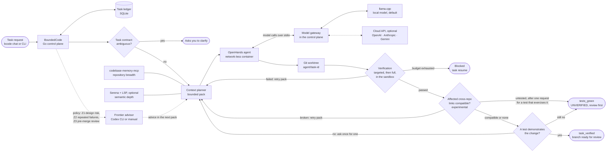

# Verification

BoundedCode decides whether a task is done with deterministic checks that
run in the sandbox, not with the agent's own judgement. This page is the
reference for what those checks establish and where they stop. For the
security side (what the sandbox prevents), see the
[sandbox design](../design/sandbox.md).

This is not formal verification. A `TASK_VERIFIED` result is evidence that a
test captures a change in behaviour, not proof that the change is correct.

## Result states

| State | Meaning |
|---|---|
| **builds** | It compiles and lints. |
| **`tests_green`** | The repository's checks pass. On its own this is weak evidence: in the initial validation, patches that changed nothing passed the existing tests. A task that ends here is reported as UNVERIFIED and is never presented as a verified merge candidate. |
| **`TASK_VERIFIED`** | The checks pass **and** there is behavioural evidence (below) in every repository whose code the change modifies. In a multi-repository task, every gRPC, protobuf or OpenAPI link that the change affects must also be `compatible`. The change must not touch how its own tests run (test integrity, below), and every layer configured as `required` must hold. |
| **`incomplete`** | Verification could not judge the change: a required tool is missing from the sandbox, or the engine failed. The task is blocked, not handed back to the agent. |

A label can carry **strength qualifiers** from the optional layers:
- `mutation established`: the tests fail on most mutants of the changed lines;
- `mutation weak`: many mutants survive;
- `N boundary untested`: mutants that move a bound (`<` to `<=`) survive;
- `counterexamples checked`;
- `counterexample found`.

These qualifiers do not lower the label unless the layer is configured as
`required`. A label never claims more than the layers show. A required
layer that was skipped, unavailable or inconclusive withholds
`TASK_VERIFIED`.

## Verification layers

Each layer is chosen by capability: what a stage does, which languages
have a mutation provider, which tools are installed. It is not written for
one language. `bcode task show` and the task view list every layer's
outcome; the task stores them as `evidence`.

| Layer | What it checks | How |
|---|---|---|
| 1 Syntax and structure | the change parses and is formatted | stages of kind `syntax` (gofmt on changed files); during the task, the per-file checks of [Languages](languages.md) |
| 2 Build and types | it compiles and type-checks | stages of kind `build` (`go build`, `go vet`, `tsc`, `cargo build`, `mvn test-compile`, CMake) |
| 3 Repository tests | the existing tests pass, and the change does not weaken them | stages of kind `test`, and the test-integrity layer |
| 4 Targeted tests | the change brings tests for what it changes | the test files it adds or modifies (Go: impact-selected packages during iteration) |
| 5 Behavioural difference | those tests fail on the base and pass on the change | [below](#behavioural-evidence) |
| 6 Mutation | the tests fail when the changed lines are broken | [below](#mutation-assessment); on by default, advisory |
| 7 Counterexamples | independent tests find no wrong behaviour | [below](#counterexamples); off by default |
| 8 Contracts | cross-repository links still hold | [below](#cross-repository-compatibility-experimental) |

A stage's kind is set with `kind:` in `.boundedcode/verification.yaml`, or
inferred from its name and command.

## Behavioural evidence

A test that the change adds or modifies (test code or test data) must:

1. **fail on the base commit with the changed tests laid over it,**
2. **not fail on the base commit without them** (a control run, so a test
   that was already failing does not count), and
3. **pass with the change.** For Go, each such test is run on the change
   and must report PASS rather than fail or skip (since v0.1.0-alpha.5).
   For other languages, the whole test stage must pass
   on the change.

Go failures are compared per test function. For other languages,
failures are compared per test where the runner names them (pytest,
unittest, cargo, Maven, Gradle, RSpec, minitest, PHPUnit, CTest, Meson).
Otherwise they are compared per stage: the stage must fail with the changed
tests and pass without them. JavaScript is always compared per stage.

These do not count as evidence:

- a changed Go test that does not compile on the base (it calls code the
  change adds): it shows that an API exists, not that it behaves as asked;
- a stage that times out on the base.

When there is no evidence, the agent is asked once for a test that
demonstrates the change. If it still cannot provide one, the task ends
`tests_green`.

## Task flow

Before each verification, the control plane checks the worktree's git
integrity and commits a checkpoint. A passing change that touches a
cross-service contract without updating the other side gets one more round
to check it.

A task that runs out of attempts, tokens or time is blocked, not failed:
`task resume` continues it.

## Cross-repository compatibility (experimental)

In a multi-repository task, each gRPC, protobuf or OpenAPI link that the
change affects gets a result: `compatible`, `broken` or `untested`. Each
result is tied to exact commits.

- **How links are checked:** the dependent repository's own checks run in
  the sandbox against the other repositories' candidate commits. Coverage,
  or a run with the OpenAPI operation removed, must show that the checks
  actually execute the link.
- **What each result does:** a broken link fails verification and is
  retried. An untested link withholds `TASK_VERIFIED`.
- **Where to see it:** `task status`, `verify --full` and the TUI's
  Verification tab show the report.
- **What is covered:** gRPC and protobuf sides written in Go (a single
  module at the repository root, a `go test` stage, generated code
  committed in a task repository), and OpenAPI sides whose tests read the
  specification. Every other shape is reported `untested`.
- **What is not checked:** a client is never run against the real server.
- **Status:** tested on fixtures only, not on real tasks.
- **Turning it off:** `repointel.compat_gate: false` turns the gate off.
  Untested links then no longer withhold `TASK_VERIFIED`.

[Design and limits](../design/cross-repo-compatibility.md).

## Gate integrity

The verification config is read from the base commit, so the agent cannot
change which stages run. The diff-scope check fails a change that touches
secret paths or protected paths (`.boundedcode/`, `.github/workflows/`,
`.gitlab-ci.yml`, `.gitmodules`, CODEOWNERS).

The commands those stages run still read the candidate's files. The
**test-integrity layer** checks the change for ways it can make its own
verification pass without testing anything. The rules come from the build
systems' and languages' descriptors, not from one language.

**Block** (verification fails; the agent is told to revert):
- a test script that verification runs: `package.json` `test`, `pretest`
  and `posttest`, or the recipe of a Makefile's `test` or `check` target;
- a wrapper or tool configuration: `gradlew`, `mvnw`, `.mvn/`,
  `gradle/wrapper/`, `.cargo/config.toml` (whose `runner = "true"` makes
  tests "pass"), `rust-toolchain`, `.npmrc` (`script-shell`), `.yarnrc*`,
  `bunfig.toml`, `.bazelrc`, `global.json`;
- a runner switch that stops tests running or failing: `skipTests`,
  `maven.test.skip`, `testFailureIgnore`, Gradle `ignoreFailures`,
  `enabled = false`, Cargo `test = false` or `harness = false`.

**Review** (verification may pass; `TASK_VERIFIED` is withheld, and the
agent is asked once to revert or justify):
- test-runner configuration: `pytest.ini`, `conftest.py`, `tox.ini`, the
  pytest sections of `pyproject.toml` and `setup.cfg`, `jest.config.*`,
  `vitest.config.*`, `.mocharc*`, `karma.conf.*`, `playwright.config.*`,
  `phpunit.xml`, `.rspec`, `Rakefile`, Maven surefire and Gradle test
  blocks, Cargo `[[test]]`, CTest registration, `*.runsettings`;
- a deleted test file that was not moved;
- assertions removed from a test without as many added;
- a line added to a test that skips, disables or focuses tests, in that
  language. Examples: `t.Skip`, `//go:build ignore`, `@pytest.mark.skip`,
  `@unittest.skip`, `it.skip`, `test.only`, `xit`, `@Ignore`, `@Disabled`,
  `#[ignore]`, `markTestSkipped`, `[Ignore]`, `XCTSkip`, `GTEST_SKIP`.

Changes to the same files that do not affect how tests run are not
flagged: a dependency in `package.json`, `pyproject.toml` or `Cargo.toml`,
or another Makefile target.

A deliberately adversarial test, for example one that detects where it
runs, is still caught only by review or hidden acceptance tests. See the
sandbox's [residual risks](../design/sandbox.md#residual-risks-known-accepted-for-now).

## Mutation assessment

Tests that pass show little if they would also pass with the change
broken. After the full gate and behavioural evidence pass, the lines the
change added or modified are mutated, a few at a time. The repository's
own test stages run on each mutant, in a scratch copy, in the sandbox:

| Language | Provider | Mutations |
|---|---|---|
| Go | its syntax tree | negated relational and logical operators, `+`/`-`, negated `if` conditions, `++`/`--`, booleans, bool and numeric return values; bounds |
| Python | its own tokenizer (strings and comments are tokens), each mutant parsed by Python's parser | negated comparisons, `and`/`or`, binary `+`/`-`, `True`/`False`, returned integers; bounds |
| JavaScript, TypeScript, Java, Kotlin, Rust, C, C++, C#, Swift, Dart, Scala, Groovy, PHP | a lexer that never touches strings, characters, template literals or comments, and changes only operators written between spaces (so not generics), booleans, returned integers and comparison bounds: same types in and out | |
| other languages | none: reported as unavailable | |

How mutants are counted:
- A mutant that does not parse, build or load is **invalid** and set
  aside; it is never counted against the tests. So is a test run that fails
  with a compile or load error.
- A mutant whose tests time out is counted apart.
- **Boundary** mutants (`<` to `<=`, a bound + 1) are run and reported, not
  scored. They find untested edges, but are often equivalent to the
  original: `clamp(v)` at `v == max` returns `max` either way. Surviving
  ones appear as "N boundary untested".
- **Established**: the tests kill at least 60% of the scored mutants, with
  at least 3 valid mutants in all. **Weak**: fewer are killed.
  **Inconclusive**: too few valid mutants.

The assessment is bounded: by default 8 mutants and 5 minutes per
repository (`task.verification.mutation_mutants`, `mutation_budget`).

A surviving mutant is not proof of weak tests, since it may be equivalent.
So the assessment never rejects a change. Weak tests are asked about once
("add assertions that would fail on these mutants"), then reported.

Two stricter settings change the label:
- `task.verification.mutation: required`: `TASK_VERIFIED` needs the
  assessment to be established.
- `strict`: additionally, every boundary mutant must be killed.

In the benchmark below, `required` made no difference. The wrong changes
were off-by-one fixes whose tests kill every scored mutant; only `strict`
told them apart. It also withholds `TASK_VERIFIED` from correct changes
whose tests check a single input.

## Counterexamples

Optional (`task.verification.counterexamples: on` or `required`). The
task's model, in a context of its own, writes up to two new test files in
the project's own framework. It sees the request, the diff and one
existing test for conventions, never the author's conversation. The
proposal is a claim, not proof. Each test runs alone, in the sandbox, on
the change and on the base:

| Outcome | Meaning |
|---|---|
| none found | the test passes on the change |
| regression | fails on the change, passes on the base |
| fails on the change | fails on the change and on the base, or cannot run on the base: the change does not do what the test expects, or the expectation is wrong |
| invalid | does not compile or load, is not a new test file, or no test stage runs it; discarded |

A failing counterexample is put to the agent once. The agent fixes the
code if the test is right, or says why it is wrong. The counterexample
lowers the label only when the layer is `required`. Generated tests can be
wrong, so a model's judgement never decides the outcome; only the runs do.

## Known limits

Measured or reproduced. The
[readiness audit](../public-launch/readiness-audit.md) has the probes.

- **Single runs.** Each evidence run happens once, so a flaky test that
  happens to fail on the base can count as evidence.
- **New API in dynamic languages.** A Python or JavaScript test that fails
  on the base only because a function or module the change adds is missing
  currently counts as evidence. Examples: `AttributeError`,
  `ModuleNotFoundError`, `TypeError: … is not a function`. In Go the
  equivalent case is rejected.
- **New API in general.** A change that only adds new API needs a test that
  also runs on the original code (Go), or it ends `tests_green`.
- **Custom Go stages.** A custom stage in `.boundedcode/verification.yaml`
  gives per-test Go evidence when its first `requires` entry is `go.mod` or
  its command is `go test`; a Go stage behind `sh -c` counts per stage.
- **Test data.** Changed test data is attributed to every test in the Go
  package that reads it, or to the whole stage for other languages.
- **Multi-repository evidence.** In a multi-repository task, every changed
  repository whose change goes beyond tests and documentation needs its
  own demonstrating test. A test in one service proves nothing about
  another service's code: in the 2026-10-27 baseline, a two-service change
  was verified by one service's test while the other service's code was
  wrong. When only one repository changed code, a repository whose change
  is documentation alone needs no test.
- **Readings of the request.** A test can only demonstrate the reading of a
  request that the agent chose. In development runs, tasks were
  `TASK_VERIFIED` yet failed hidden acceptance tests:
  - 3 in the final failure-driven run, where the issue allowed another
    reading or the hidden test required details the issue did not state;
  - 2 in the targeted pass's development checks.

  See [§C of the failure-driven report](../benchmarks/failure-driven-engineering-2026-10.md#c-verification-why-false-passes-happened-what-prevents-them-now)
  and [verification honesty](../benchmarks/targeted-engineering-pass-2026-10.md#verification-honesty-in-the-development-checks).
- **Adversarial tests.** A deliberately adversarial test, for example one
  that detects where it runs, is caught only by review.

## Measured

See [the verification benchmark](../benchmarks/verification-benchmark-2026-10.md):
one specification implemented in Go, Python, JavaScript, TypeScript, Rust,
Java and a mixed Go and Node repository, with correct changes, wrong
changes and weakened tests. Each change's correctness is checked with
hidden acceptance tests. False acceptance and false rejection are reported
separately, per pipeline, with the time each takes.

## Configuration

Built-in presets cover Go, JavaScript/TypeScript, Python, Rust, Java (Maven,
Gradle), C/C++ (CMake, Meson, Autotools, Make), Ruby and PHP without
configuration. A repository can override them in
`.boundedcode/verification.yaml`. See the
[configuration reference](configuration.md#repository-verification-boundedcodeverificationyaml).

Verification runs offline, so a project's dependencies must already be
installed. They can be in the checkout (`node_modules`, `.venv`, `vendor`)
or in this machine's package caches (Go, Cargo, Maven, Gradle).
